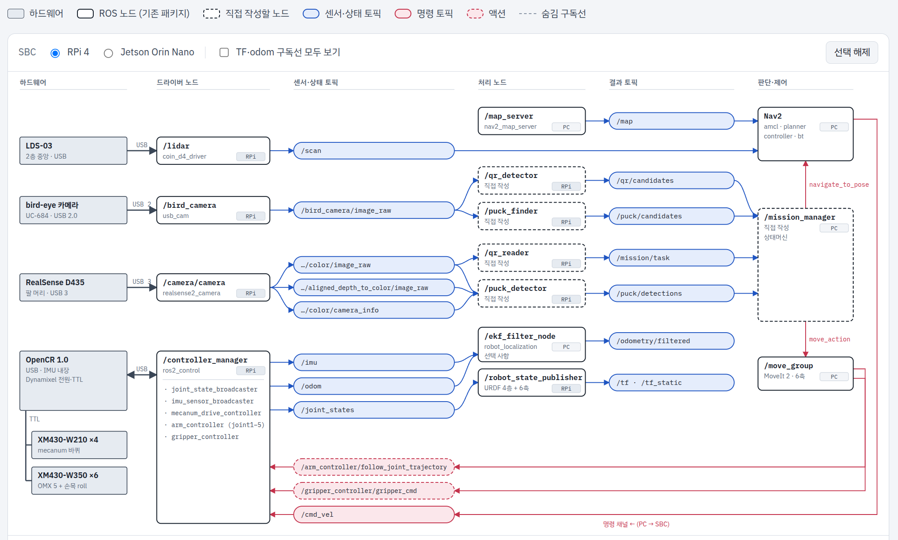

# 🗓️ TIL: 퍽 로봇 센서 구성과 ROS 2 노드·토픽 파이프라인 설계

### 핵심 키워드

#ROS2 #HW설계 #센서 #SW설계

---

## 오늘 공부한 것

### 하드웨어 구성

- **구동부**
	- Mecanum 45° 바퀴 4개, 바퀴 모터 4개 (XM430-W210, velocity 모드)
	- 시뮬레이션은 Isaac Sim에서 메카넘 주행 포함 or not 결정해야할 듯
- **조작부**
	- OpenManipulator-X 1대 + 손목 roll용 6번째 모터 1개 → 팔 모터 총 6개(joint1–5 + gripper)
	- 손목에 RealSense D435 부착(eye-in-hand). 커스텀 브래킷 직접 설계 필요
- **연산·제어**
	- OpenCR: 바퀴 4 + 팔 6 = Dynamixel 10개를 TTL 버스 하나로 연결
	- 온보드 SBC는 RPi 4 또는 Jetson Orin Nano 중 1대만 사용
	- 원격 PC: Nav2·MoveIt·미션 관리·RViz

| 센서 | 위치 | 연결 | 드라이버 → 토픽 |
| --- | --- | --- | --- |
| LDS-03 라이다 | 2층 중앙 | USB → 허브 → SBC | `coin_d4_driver` → `/scan` |
| bird-eye 카메라 (Arducam UC-684, IMX291, 3.6mm) | 프로파일 위, 전방 20–30° 아래 | USB 2.0 → 허브 → SBC | `usb_cam` (MJPEG) → `/bird_camera/image_raw` |
| RealSense D435 | 팔 머리(손목) | USB 3 → SBC 직결 | `realsense2_camera` → `…/color`, `…/aligned_depth` |
| IMU (OpenCR 내장) | 3층 | USB → SBC | `imu_sensor_broadcaster` → `/imu` |
| 바퀴 엔코더 ×4 | 1층 | TTL → OpenCR | `mecanum_drive_controller` → `/odom` |
| 팔 엔코더 ×6 | 4층 | TTL → OpenCR | `joint_state_broadcaster` → `/joint_states` |

### 카메라 역할 분담

- **bird-eye (UC-684)**: 주행 중 QR·퍽 후보 **탐지** 전용
	- QR 10 cm 기준 1080p에서 1 m 약 124 px(판독 가능), 2 m 약 62 px(경계), 3 m 약 41 px(탐지만)
	- 1 m 이내면 bird-eye로 직접 판독 시도 → 성공 시 D435 단계 생략
- **D435**: 정지 후 QR **판독**, 퍽 R/G/B 분류와 3D 위치 추정
	- D435 frame은 손목 링크의 자식 → 팔 자세에 따라 TF가 바뀜 ⭐


### RPi 4 예산 (추정치)

- CPU 합계 약 115–240% / 400% (전체의 30–60%)
	- 탐색 단계(bird-eye)와 근접 단계(D435)가 동시에 최대 부하가 되지 않는다는 전제
	- `realsense2_camera`는 424×240 @15, 근접 단계에서만 켜고 전체 align은 끔 → 퍽 중심 픽셀만 좌표 변환
- Wi-Fi 전송 약 0.2–0.3 MB/s: 영상은 연속 전송하지 않고 결과 토픽만 전송
- 지연

| 루프                | 추정 지연      | 처리                                                                    |
| ----------------- | ---------- | --------------------------------------------------------------------- |
| 모터 제어 (SBC 내부)    | 10 ms      | 네트워크 무관                                                               |
| 주행 (Nav2 ↔ Wi-Fi) | 100–300 ms | 0.2–0.3 m/s면 3–9 cm 이동, inflation으로 흡수, `reference_timeout` 0.3–0.5 s |
| QR 판독·퍽 집기        | 수백 ms–1 s  | 정지 후 단발 처리라 문제없음                                                      |

- 모터 버스: XM430 Return Delay Time 기본 500 µs → 0으로 설정하면 모터 10개 1주기 약 4 ms, 100 Hz 가능

### ROS 2 파이프라인

```
하드웨어 → 드라이버 노드 → 센서·상태 토픽 → 처리 노드 → 결과 토픽 → 판단·제어 → 명령 → /controller_manager
```

- **SBC**: 드라이버, `/controller_manager`, `/robot_state_publisher`, 인식 노드
- **PC**: `/map_server`, Nav2, `/move_group`, `/mission_manager`, `/ekf_filter_node`(선택)
- **직접 작성할 노드**

| 노드 | 입력 | 출력 | 역할 |
| --- | --- | --- | --- |
| `/qr_detector` | `/bird_camera/image_raw` | `/qr/candidates` | QR 위치 탐지(약 5 Hz), 카메라→QR 방향을 맵 벽과 교차해 맵 좌표 계산 |
| `/puck_finder` | `/bird_camera/image_raw` | `/puck/candidates` | HSV 임계값으로 퍽 후보 검출(640×360, 5–10 Hz) |
| `/qr_reader` | `…/color/image_raw` | `/mission/task` | 정지 후 zbar 또는 `cv2.QRCodeDetector`로 판독 → task 파싱 |
| `/puck_detector` | color + aligned_depth + camera_info | `/puck/detections` | 색 분류 + 중심 픽셀 depth로 3D 좌표 → TF로 `base_link`/`map` 변환 |
| `/mission_manager` | 후보·task·detection 토픽 | `navigate_to_pose`, `move_action` | 상태머신 |

- **mission_manager 상태 흐름**

```
주행 중 후보 수집 → QR 후보로 이동 → D435 판독(근거리 판독 성공 시 생략)
→ task 해석 → 목표 퍽 후보로 이동 → D435 정밀 위치 → 팔로 집기·밀기 → 적재함
```



---

## 느낀점

- 설계할게 너무 많다!
- 의논할 사안이 많아지면서 정리할 내용이 많아짐 - 자동화 필요성이 느껴진다..
	- skills을 활용해서 만들어봐야겠다.
- HW 파트를 빨리 정하고 SW 개발로 들어가야할 것 같다.