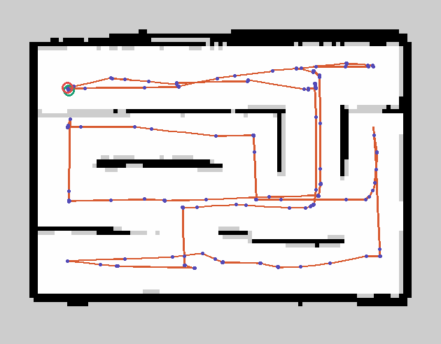
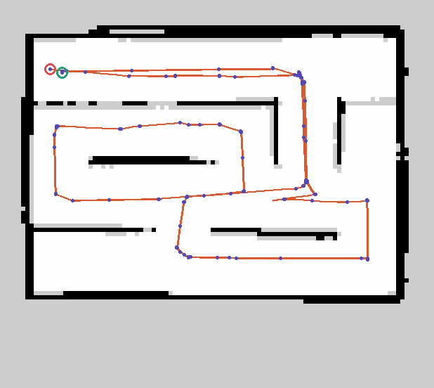

# 🗓️ TIL: Jetson Orin Nano 조건 Cartographer 2D SLAM 최적화

### 핵심 키워드

#Cartographer #SLAM #JetsonOrin #루프클로저 #파라미터튜닝

---

## 오늘 배운 것

### `max_range`와 `missing_data_ray_length`

- **관련 파라미터** (`waffle_2d.lua`, TurtleBot3 Waffle Gazebo)
	- `TRAJECTORY_BUILDER_2D.min_range`, `TRAJECTORY_BUILDER_2D.max_range`, `TRAJECTORY_BUILDER_2D.missing_data_ray_length`
	- LDS 사양: 0.12~3.5m / 360 samples / 10Hz

- **동작 원리**
	- `max_range`보다 먼 측정점은 버려지고 **miss**로 처리됨
	- miss 방향으로 `missing_data_ray_length`만큼 **free space(흰색)** 가 삽입됨
	- `missing_data_ray_length > max_range`이면 `max_range`~`missing_data_ray_length` 구간의 벽이 free space로 덮임 ⭐

- **실험**: `max_range = 1.5`, `missing_data_ray_length = 3.`
	- 1.5~3.0m 거리의 벽이 free space로 덮여 **이미 그린 벽이 계속 지워짐**
	- 흰 영역이 미로 밖까지 번짐

```text
규칙: missing_data_ray_length ≤ max_range
```

- **`max_range` 조정 시 trade-off**

| 방향               | 효과                     | 비고                                              |
| ---------------- | ---------------------- | ----------------------------------------------- |
| 줄임               | 레이 캐스팅 셀 수 감소 → CPU 절약 | 너무 짧으면 보이는 벽이 적어 scan matching·loop closure 불안정 |
| 센서 사양(3.5m)보다 늘림 | 효과 없음                  | 실제 로봇은 LDS-02(약 0.16~8m)일 수 있어 사양 확인 필요         |

```text
레이 캐스팅 셀 수 (해상도 0.05m)
max_range 3.5m → 3.5 / 0.05 ≈ 70셀
max_range 2.0m → 2.0 / 0.05 ≈ 40셀
```

---

### Jetson Orin Nano 조건 Cartographer 최적화

- **대상 사양**: 6코어 Arm Cortex-A78AE 1.7GHz, 8GB LPDDR5, 7~25W
- **목표**: CPU 사용량 자체가 아니라 아래 세 가지를 동시에 만족
	1. 실시간 유지: LiDAR 10Hz → 스캔당 `0.1s` 안에 처리
	2. 다른 노드(Nav2·드라이버)용 자원 여유있어야 함
	3. 지도 정확히 만들기


- **PC에서 Jetson 환경으로 세팅**
	- **코어 6개 + 메모리 8GB**
		- `systemd-run --scope -p AllowedCPUs=0-5 -p MemoryMax=8G`

- **변경한 파라미터** (`src/waffle_slam_course/config/waffle_2d.lua`, 기본값은 `src/cartographer/configuration_files/*.lua`)

| 파라미터                                                                               | 원래              | 변경             | 이유                                           |
| ---------------------------------------------------------------------------------- | --------------- | -------------- | -------------------------------------------- |
| `pose_publish_period_sec`                                                          | `5e-3` (200Hz)  | `20e-3` (50Hz) | 발행 주기, 품질 영향 거의 없음                           |
| `trajectory_publish_period_sec`                                                    | `30e-3`         | `100e-3`       | 시각화용                                         |
| `submap_publish_period_sec`                                                        | `0.3`           | `0.5`          | 시각화용                                         |
| `MAP_BUILDER.num_background_threads`                                               | `4`             | `2`            | 6코어에서 다른 노드 몫 남기기                            |
| `POSE_GRAPH.optimization_problem.ceres_solver_options.num_threads`                 | `7`             | `2`            | 코어 수(6)보다 많았음                                |
| `TRAJECTORY_BUILDER_2D.max_range` / `missing_data_ray_length`                      | `3.5` / `3.`    | `2.5` / `2.`   | `missing_data_ray_length ≤ max_range` 유지     |
| `POSE_GRAPH.constraint_builder.sampling_ratio`                                     | `0.3`           | `0.15`         | 루프 클로저 검사 횟수 감소                              |
| `POSE_GRAPH.constraint_builder.max_constraint_distance`                            | `15.`           | `4.`           | 후보 submap 거리 필터                              |
| `POSE_GRAPH.constraint_builder.fast_correlative_scan_matcher.linear_search_window` | `7.`            | `3.`           | 탐색 범위 축소                                     |
| `TRAJECTORY_BUILDER_2D.motion_filter.max_angle_radians`                            | `math.rad(0.1)` | **유지**         | TurtleBot3(ROBOTIS) 설정값                      |
| `use_online_correlative_scan_matching`                                             | `true`          | **유지**         | Gazebo odom 미끄러짐 보정 중 (odom 3.2m vs 실제 0.2m) |

- **`motion_filter` 주의점**
	- 필터는 submap 삽입 여부만 결정함
	- 스캔 매칭은 필터와 무관하게 모든 스캔에 수행됨 ⭐

- **`constraint_builder` = inter constraint(루프 클로저)를 찾는 부품**

```text
① 후보 선정      sampling_ratio, max_constraint_distance
② 대략 탐색      fast_correlative_scan_matcher
③ 정밀 매칭      ceres_scan_matcher
④ 채택 판정      score ≥ min_score (waffle: 0.65)
```

- 루프 클로저는 **출발점 복귀가 아니어도** 이전에 그린 submap을 다시 보면 발생함 (주행 내내 백그라운드에서 계산)
- 거리 필터의 의미
	- 넓은 지도에서 계산량 폭발 방지, 가망 없는 후보 제거, 비슷한 장소 오매칭 방지
	- 이 미로는 가운데 벽으로 위/아래가 분리됨 → 주행 가능 영역 약 4.4×3.2m(대각선 약 5.4m) → `8m`·`15m`는 필터 효과 없음

- **지도 해석**

| 색         | 의미                  | 원인                                  |
| --------- | ------------------- | ----------------------------------- |
| 진회색       | 미관측 (unknown, `-1`) | 레이가 닿지 않음                           |
| 흰~검 사이 회색 | 점유 확률 불확실           | 조금만 봄 / 결과 엇갈림 (위치 흔들림, 3mm 얇은 가로벽) |

---

### 주행 경로와 결과 지도

- **결과** 
최종 버전 1


최종 버전 2


- **실행한 명령어**

```bash
# 공통 환경 (다른 PC와 섞이지 않게: domain 17 + localhost 한정, 실물 로봇 peer 해제)
unset ROS_STATIC_PEERS && export ROS_DOMAIN_ID=17 ROS_AUTOMATIC_DISCOVERY_RANGE=LOCALHOST && source /opt/ros/lyrical/setup.bash

# 0) 이전 Gazebo 정리
pkill -f "gz sim"; pgrep -af "gz sim"

# 1) Gazebo (Gazebo 통신도 로컬 한정)
cd ~/Desktop/physical_ai/projects/waffle-lyrical-slam && export GZ_PARTITION=waffle_jje GZ_IP=127.0.0.1 && source install/setup.bash && source gazebo_install/setup.bash && ros2 launch waffle_slam_course gazebo.launch.py gui:=true

# 2) Cartographer (Jetson 자원 제한)
source install/setup.bash && systemd-run --user --scope -p AllowedCPUs=0-5 -p MemoryMax=8G ros2 launch waffle_slam_course cartographer.launch.py

# 3) RViz (Fixed Frame=map, /map, /scan, TF, /constraint_list(MarkerArray), /trajectory_node_list)
rviz2 --ros-args -p use_sim_time:=true

# 4) 키보드 조종 (회전 0.1 rad/s, 멈출 땐 k)
ros2 run teleop_twist_keyboard teleop_twist_keyboard --ros-args -p stamped:=true -p frame_id:=base_footprint -p use_sim_time:=true -p speed:=0.1 -p turn:=0.1

# 5) 측정
top -p $(pgrep -d, -f cartographer_)

# 6) 지도 저장 (SLAM 켜진 상태, 같은 터미널에서)
source install/setup.bash && mkdir -p maps && MAP_PREFIX="$PWD/maps/maze_$(date +%Y%m%d_%H%M%S)" && ros2 run nav2_map_server map_saver_cli -f "$MAP_PREFIX" --ros-args -p use_sim_time:=true
ros2 service call /write_state cartographer_ros_msgs/srv/WriteState "{filename: '${MAP_PREFIX}.pbstream', include_unfinished_submaps: true}"
# (선택) 저장 직전 최종 최적화
ros2 service call /finish_trajectory cartographer_ros_msgs/srv/FinishTrajectory "{trajectory_id: 0}"

# 7) odom vs Gazebo 실제 위치 비교 (미끄러짐 확인)
ros2 topic echo /odom --field pose.pose.position
gz topic -e -t /world/default/pose/info | grep -A4 'name: "waffle"'
```

| 파일 | 내용 | 용도 |
| --- | --- | --- |
| `.pgm` / `.yaml` | 점유 격자 지도 | Nav2 |
| `.pbstream` | Cartographer 전체 상태 (submap·노드·제약) | 이어 그리기, pure localization |

- lua 수정은 `--symlink-install`이라 **재빌드 불필요, SLAM만 재시작**

---

## 알게 된 것

- `max_range` 밖 측정은 miss → `missing_data_ray_length`만큼 free space 삽입 → `missing_data_ray_length ≤ max_range`가 아니면 이미 그린 벽이 지워짐 (실패를 통해 깨달음..)
	- 파라미터를 수정할 때는  **연결된 파라미터를 함께** 조정해야 함 ⭐
- 최적화 목표는 CPU 사용량이 아니라 실시간(스캔당 `0.1s`) + 다른 노드 여유 + 지도 품질 만족
- `constraint_builder`의 거리 필터(`max_constraint_distance`)는 지도 크기보다 작아야 의미가 있음 → 이 미로(대각선 약 5.4m)에서는 `15m`가 사실상 필터 없음과 같음 → 갑 수정
- `motion_filter`는 submap 삽입 여부만 결정, 스캔 매칭은 모든 스캔에 수행됨

---

## 느낀점

- 저번주에는 팀프로젝트로 target tracking을 구현했다. 일주일동안 코드도 짜고, 보고서도 작성해야해서 바빴다. TIL 대신 노션에 따로 개인 일지를 작성했다. 추후 정리해서 올려야겠다.
- Map을 따는게 여간 어려운 일이 아니다. 파라미터 튜닝을 시키는데, 하나하나 공부하면서 시켜야했다. 맵도 잘 만들어가다가 마지막에 튀면서 맵의 벽이 흔들려 어긋나는 케이스도 있었다. 거의 8트??는 한 듯..
- 최종 버전 1, 2 둘다 마음에 안들어서 시간 날 때, 다시 튜닝해야겠다.